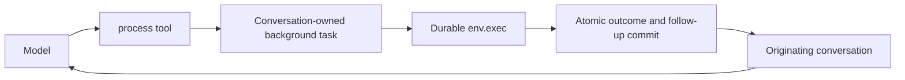

+++
status = "final"
created = 2026-11-19
last_update = 2026-11-24
+++

# Background processes v0

## Purpose

Let an agent run a bounded shell command without holding its current turn. Completion must submit the result as input to the originating conversation so an idle agent can act without another user message.

## Context

`pid-process` is a standalone user extension for Pi Durable 1.5.2. pid-acp loads its default-exported Durable extension through `PID_ACP_EXTENSIONS` before opening the Harness and recovering saved work. pid-acp needs no changes to load it.

## Goals

- Expose one model tool, `process(command, timeout)`, that returns a job ID without waiting for the command.
- Submit a follow-up on completion, including failures and timeouts.
- Preserve pending jobs and completion delivery across restart without replaying a command that may have started.

## Non-goals

- Job listing, live output retrieval, explicit stop, stdin, readiness watches, or a UI.
- A separate subprocess supervisor, reattachment to OS processes, or migration from Dex's `pi-processes`.
- New ACP methods or changes to Durable's follow-up scheduling.

## Specification

### Admission and execution

- The tool schema must declare `command` as a required string and `timeout` as a required number in seconds. Let Durable validate the schema before admission and let `env.exec()` enforce its own execution constraints. Pass both arguments through without additional validation or normalization.
- The tool must use `api.createTask` with `{ ownership: { kind: "conversation" }, background: true }` and return the task ID once admitted. The tool must not be replay-safe: if interrupted after admission but before returning the ID, the admitted job continues under its original ID. A job must not keep the initiating turn busy; ACP disconnect and ordinary prompt cancellation must not cancel the job.
- The task must await `env.exec(command, { timeout, onOutput }, context)` in the originating conversation's execution environment and default working directory. It must honor task cancellation through the execution context and use `onOutput` to retain a bounded tail of both streams in arrival order. The operator enables trusted shell execution with the same authority as the host's `bash` tool; this is not a sandbox.

### Completion and recovery

- On exit or execution error (including unavailable environment, runner rejection, launch failure, or timeout), submit a native `{ type: "input" }` follow-up to the originating conversation using the default busy policy. This must start a run if idle or queue input for the next run if busy; it must not steer the active run or emit only a passive notification. If the active run fails, Durable may leave the follow-up queued until another input. The extension adds no wake-up or retry in that case.
- The follow-up must identify the job and outcome, include the exit code when available, and include at most 8 KiB of recent stdout and stderr combined, as valid UTF-8 and marked if truncated. Treat output as untrusted command data. Do not send raw command output to server diagnostics.
- Commit the terminal outcome and follow-up admission together, using a stable request ID derived from the job ID. Each job must admit at most one completion submission; Durable may batch queued inputs into one run.
- Save a `maybe_started` checkpoint immediately before starting the command. On recovery, a job still in `not_started` may start; a job in `maybe_started` without a terminal outcome must report `interrupted` through the same follow-up path and must not relaunch. `interrupted` means the command's outcome is unknown, not that the OS process is confirmed stopped.

## Verification

- Load the extension through `PID_ACP_EXTENSIONS` in a fresh pid-acp process. Verify a call missing a required argument creates no job and a valid call returns its job ID before a delayed command exits.
- With harmless commands and a deterministic provider, verify success, nonzero exit, launch failure, timeout, and a runner-rejected timeout value report the expected outcome and respect the combined output bound, including with interleaved multibyte output. Verify that only the originating conversation receives the follow-up.
- Exercise idle and busy completion through ACP. Verify an idle completion starts a model call without user input and its reply is delivered over ACP; a busy completion waits for the active run to answer rather than steering it. Verify that a job can complete after the initiating ACP attachment closes. If the active run fails, verify the queued completion reaches the model on the next input without resubmission.
- Restart pid-acp after job admission but before the tool reply, before the `maybe_started` checkpoint, after that checkpoint, and after the completion commit. Verify that recovery never launches a job in `maybe_started`, an `interrupted` follow-up if the result was not committed, and no duplicate completion submission.
